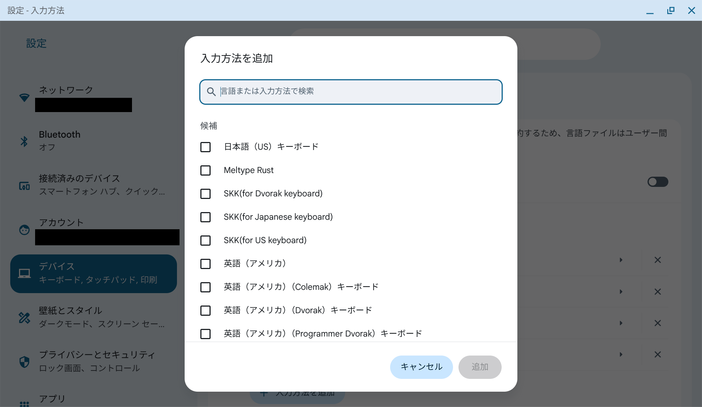
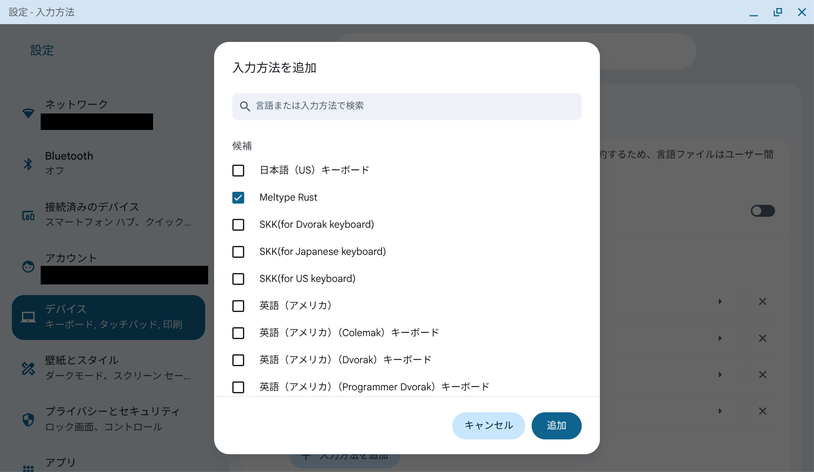
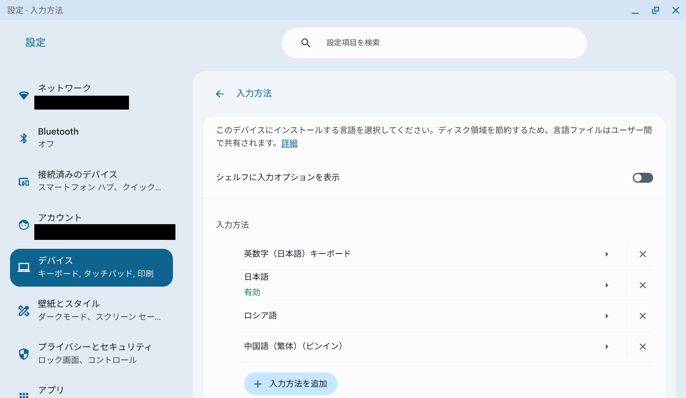
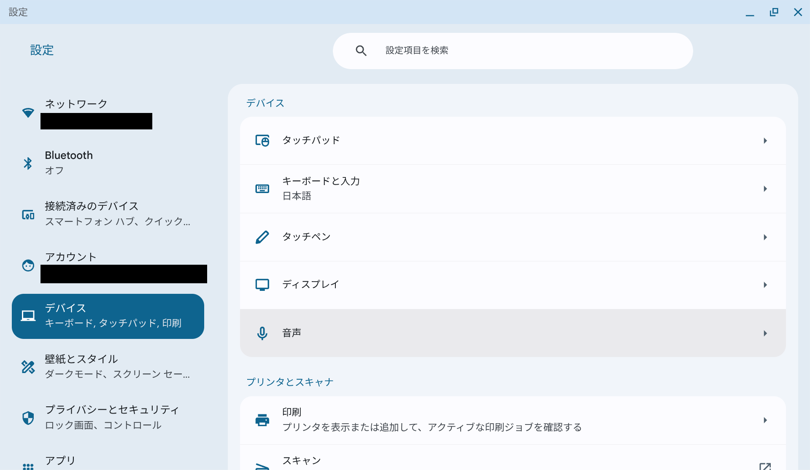
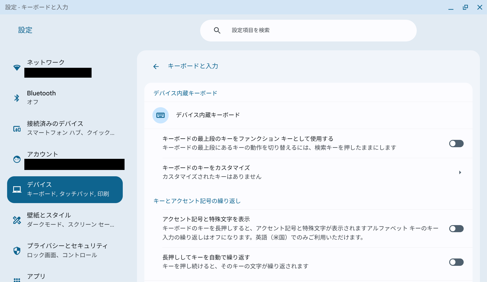
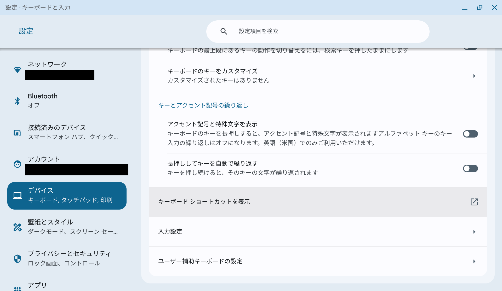
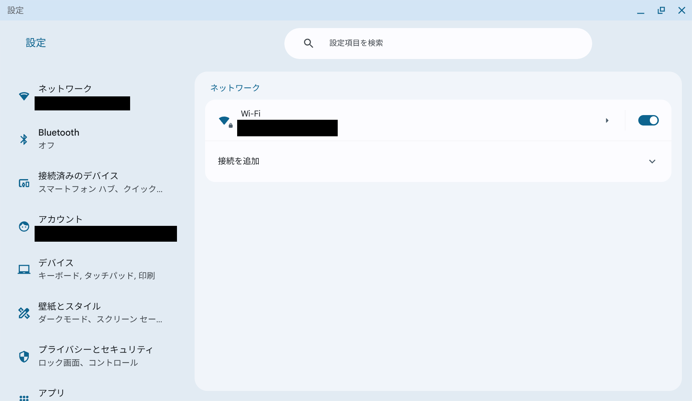

# ChromeOS実機の導入画面

<!-- meltype-flash-document-banner:start -->

<!-- meltype-flash-document-banner:end -->

ユーザーから公開許可を得た7枚です。Wi-FiのSSIDとユーザー名（アカウントのメール表示を含む）を黒塗りし、PNGのメタデータを除去しました。黒塗り以外の画素は変更していません。個人情報を含む元ZIP・元画像はリポジトリに入れていません。

この画面は入力方法にMeltype Rustが表示されることを示します。漢字変換・候補操作の実機受入の証拠ではありません。OSの版・管理設定で配置や表記は変わります。

1. 拡張機能を読み込み、ChromeOSの設定で「デバイス → キーボードと入力 → 入力設定」を開きます。
2. 「入力方法を追加」で「Meltype Rust」にチェックし、右下の「追加」を押します。
3. 「シェルフに入力オプションを表示」をONにし、シェルフの入力方法から「Meltype Rust」を選びます。単に日本語やMeltypeを追加しただけでは、使用中の入力方法は切り替わりません。
4. 入力欄で`hashi` → Spaceを押し、「橋」「箸」などの候補を選んでEnterで確定します。設定の判定結果や同梱辞書によって候補は変わります。

## 入力方法を追加

## 入力方法一覧

以下は追加前の一覧です。「日本語」が有効であることと「Meltype Rust」が選択されていることは別です。

## 設定の経路

## ネットワーク設定

SSIDはサイドバーと中央の両方を隠しています。

