<!-- meltype-flash-platform:start -->
<p align="center">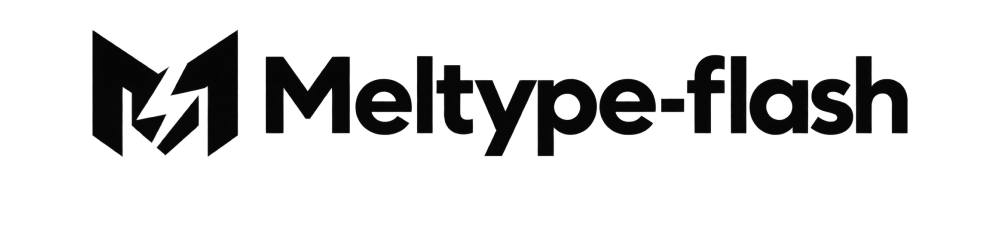</p>
<a id="meltype-for-ios"></a>
<p align="center">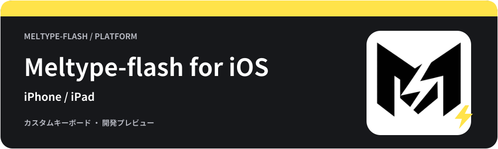</p>
<p align="center"><b>稲妻のように、言葉の壁を駆け抜ける日本語入力。</b></p>
<p align="center"><a href="https://github.com/appipinopi/Meltype-Flash/releases/tag/flash-v0.1.0-preview.5"></a> </p>
<p align="center"><a href="#インストール">ダウンロード・導入</a> · <a href="#使い方">使い方</a> · <a href="#困ったとき">困ったとき</a> · <a href="https://github.com/appipinopi/Meltype-Flash/issues/new/choose">不具合の報告・提案</a></p>
<p align="center">
  <a href="../rust/WINDOWS-PACKAGE.md">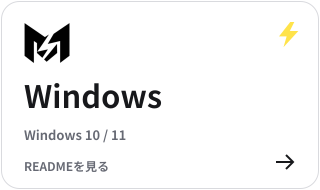</a>
  <a href="../linux/README.md">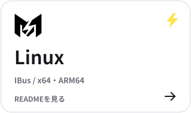</a>
  <a href="../mac/README.md">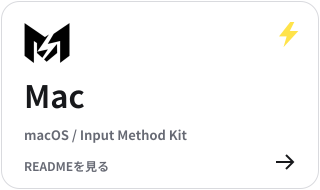</a>
</p>
<p align="center">
  <a href="../android/README.md">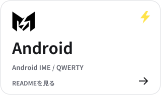</a>
  <a href="../chromeos/README.md">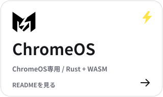</a>
  <a href="README.md">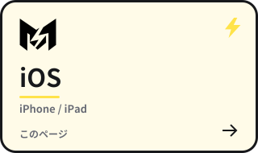</a>
</p>
<p align="center"><a href="../README.md">トップのREADME</a></p>
<!-- meltype-flash-platform:end -->

iPhone・iPadのカスタムキーボードとして動く、Rust版Meltype-flashの初期プレビューです。
**未確定文字はキーボードの中に表示し、確定した文字だけを入力欄へ送ります。**

<a id="内容"></a>
<h2>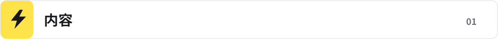</h2>

QWERTY入力、英語・日本語の判定、補助辞書による候補、空白・削除・確定を実装しています。
フリック入力、デスクトップの外部変換エンジン、翻訳、アプリ別設定、学習・設定の永続保存は未対応です。
実機の各アプリでの入力やApp Store審査を完了した製品ではありません。

[動く環境](#動く環境) · [インストール](#インストール) · [使い方](#使い方) · [困ったとき](#困ったとき) · [アンインストール](#アンインストール) · [開発者向け](#開発者向け)

<a id="動く環境"></a>
<h2>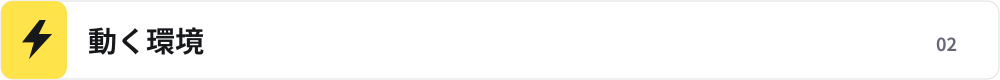</h2>

- iOS 15以降のiPhone / iPad。
- 実機へ導入するには自分の署名が必要です。
- Simulator向けZIPはApple Silicon MacのiOS Simulator用で、iPhoneへは入りません。

iOS側が標準キーボードへ切り替えるパスワード欄や、外部キーボードを禁止したアプリでは使えません。

<a id="インストール"></a>
<h2>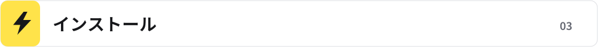</h2>

[FlashのPre5](https://github.com/appipinopi/Meltype-Flash/releases/tag/flash-v0.1.0-preview.5) の配布から、目的に合うものを選びます。

| ファイル | 用途 |
| --- | --- |
| `Meltype-flash-iOS-unsigned.ipa` | 自分のApple IDなどで署名して実機へ導入するための未署名IPA |
| `Meltype-flash-iOS-source.zip` | Xcodeで自分のチーム・Bundle Identifierを設定してビルドするためのソース |
| `Meltype-flash-iOS-Simulator-arm64.zip` | Apple Silicon MacのSimulator向け。実機には非対応 |

IPAをファイルアプリで開いたり、ZIPの拡張子を変更したりするだけでは導入できません。

<a id="windowsから自分のiphoneへ入れる"></a>
<h3>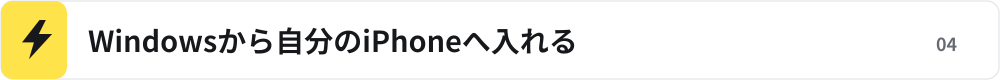</h3>

1. [AltStore ClassicのWindows向け公式手順](https://faq.altstore.io/altstore-classic/how-to-install-altstore-windows) に従い、必要なApple製ソフトとAltServerをPCに用意します。
2. iPhoneをUSB接続し、「このコンピュータを信頼」を許可してAltStore Classicを導入します。Apple IDはAltServer / AltStoreの画面で扱います。
3. 必要に応じてiPhoneの「VPNとデバイス管理」で開発元を信頼し、iOSの案内に従ってデベロッパモードを設定します。
4. AltStore Classicの「My Apps」の＋から未署名IPAを選びます。**アプリ拡張を選べる場合はキーボード拡張を残してください。削除するとキーボードとして使えません。**
5. 署名に使うアカウントの更新期限・App ID枠を確認し、必要な更新を続けます。

AltStore PALとは別の導入方法です。[更新と制限](https://faq.altstore.io/altstore-classic/your-altstore)、[App IDの説明](https://faq.altstore.io/altstore-classic/app-ids) も参照してください。
この経路による実機入力は未検証です。署名・導入サービス側の画面や条件は公式の案内を優先してください。

<a id="キーボードを有効にする"></a>
<h3>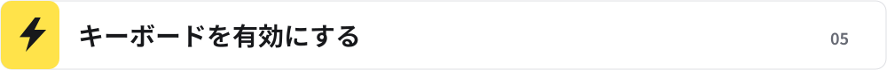</h3>

導入後は「設定 → 一般 → キーボード → キーボード → 新しいキーボードを追加」からMeltype-flashを追加し、入力欄で🌐から選びます。
**フルアクセスの許可は不要です。**

<a id="使い方"></a>
<h2>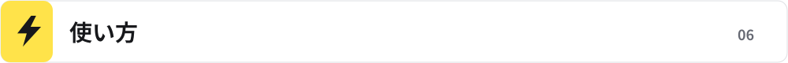</h2>

文字キーで入力し、キーボード上部の未確定表示と候補を確認します。候補の選択または確定ボタンで入力欄へ送ります。
空白・削除などはキーボード上のボタンを使い、🌐から別のキーボードへ戻れます。
入力欄を移動すると未確定入力を破棄し、確定済みの文字をさかのぼって修正しません。

<a id="プライバシー"></a>
<h2>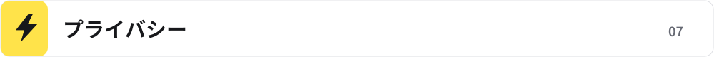</h2>

通信・フルアクセス・アプリ間の共有領域は使いません。学習・設定の永続保存も無効です。
キーボードの制限はiOSと使用中のアプリの挙動にも従います。
署名・アプリ導入に使うApple IDや認証情報を不具合報告へ添付しないでください。

<a id="困ったとき"></a>
<h2>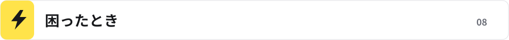</h2>

<details>
<summary>キーボード一覧に出ない</summary>

アプリ本体だけでなく、キーボード拡張も署名・導入されているか確認してください。AltStoreで拡張を外した場合はキーボードを追加できません。
Simulator用ZIPを実機に使っていないかも確認してください。

</details>

<details>
<summary>アプリによって標準キーボードに戻る・入力できない</summary>

iOSはパスワード欄などで標準キーボードへ切り替えます。ホストアプリが外部キーボードを拒否する場合もあります。
通常のテキスト欄でも再現する場合は、iOS・アプリ名・導入した版・入力手順を [Issues](https://github.com/appipinopi/Meltype/issues/new/choose) に記載してください。

</details>

<a id="アンインストール"></a>
<h2>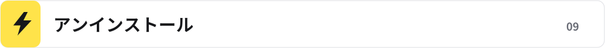</h2>

設定のキーボード一覧からMeltype-flashを外し、ホーム画面またはアプリ一覧からアプリ本体を削除します。
署名・更新に使った導入サービス側の登録やデータの扱いは、そのサービスの案内に従ってください。

<a id="開発者向け"></a>
<h2>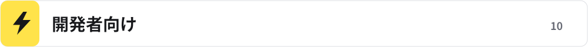</h2>

MacにXcode、Rust、XcodeGenを用意し、リポジトリのルートから実行します。

```sh
bash ios/build.sh
```

Apple SiliconのSimulator向けZIPと未署名の実機向けアプリを作ります。
実機用は `ios/MeltypeFlash.xcodeproj` をXcodeで開き、アプリ本体とキーボード拡張の両方へ自分の開発チームと固有のBundle Identifierを指定して署名します。
TestFlight / App Store配布には配布署名とプロビジョニングが必要です。このリポジトリから署名済みIPAやApp Store公開は行っていません。
Rust ABIの入力・確定・長文・セッション分離と、Xcodeのビルド検証を行います。実機のメモリー使用量や各アプリとの相性は別途確認が必要です。
Appleの [カスタムキーボード資料](https://developer.apple.com/documentation/uikit/creating-a-custom-keyboard) も参照してください。

<a id="ライセンス"></a>
<h2></h2>

[GPL-3.0-or-later](../LICENSE)。辞書などの表示は [THIRD-PARTY-NOTICES.md](../THIRD-PARTY-NOTICES.md) を参照してください。
