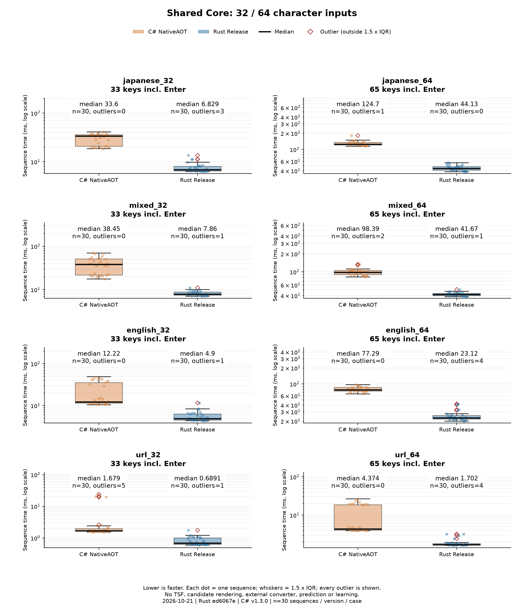
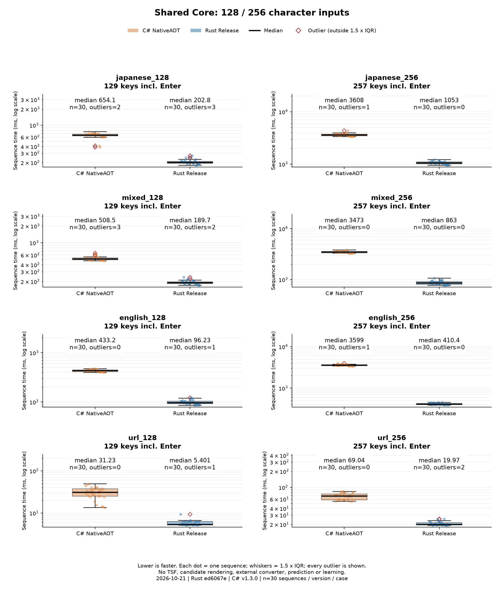
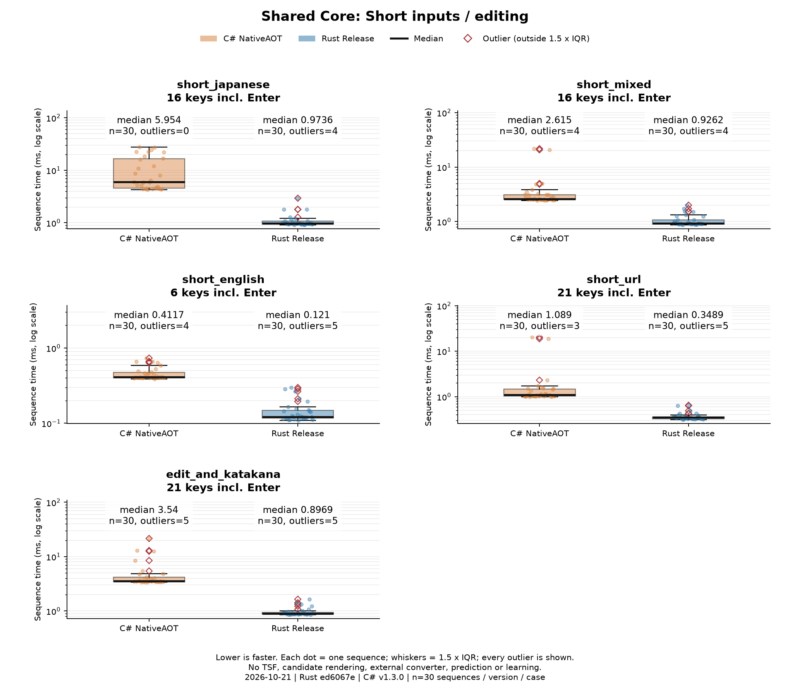
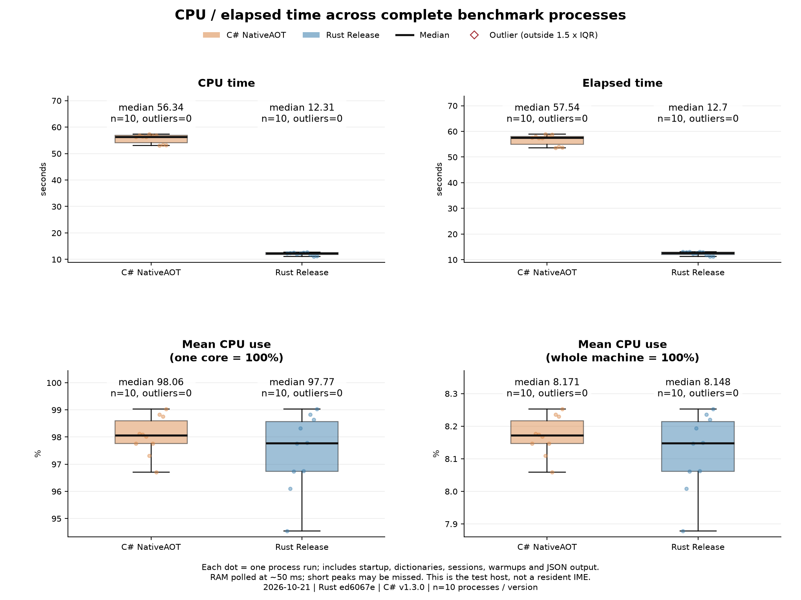
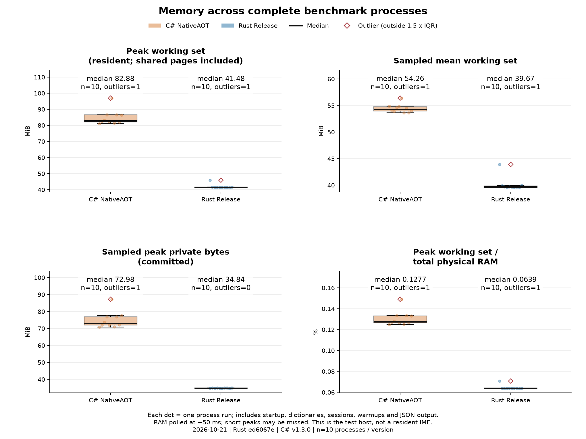

# Windows共通Coreの再測定（2026-10-21）

<!-- meltype-flash-document-banner:start -->
<p align="center"></p>
<!-- meltype-flash-document-banner:end -->

C# v1.3.0 NativeAOT と Rust `ed6067e` Release。比較可能な入力は 21/21、Rustの中央値が短い入力は 21/21。

## 条件と箱ひげ図の読み方

各入力・各版 3 試行 × 10 巡、各巡 1 回ウォームアップ。C#→Rust、Rust→C#を交互に実行。CPU・RAMは各版 10 プロセスを独立した観測値とする。
測定環境: Windows-11-10.0.26300-SP0 / AMD Ryzen 5 5600H with Radeon Graphics / 12論理CPU / OS可視RAM 63.40 GiB。rustc 1.99.1 (58cf8f9c3 2026-10-13) / .NET 10.0.402。

四分位数は線形補間（type 7）。箱はQ1〜Q3、黒線は中央値、ひげはQ1−1.5×IQR〜Q3＋1.5×IQR内の最端の観測値。赤い菱形は外れ値。外れ値を除外せず、各パネルに中央値・n・外れ値数を表示する。青/橙の点は全観測値。速度図の縦軸は対数で、統計は元のms値から計算する。

速度はCoreの打鍵＋JSON応答生成。セッション生成・辞書構築・起動は区間外。CPU・RAMはそれらとウォームアップ・JSON出力を含むプロセス全体。外部変換・OSスペル・ライブ変換・予測・学習・TSF・候補描画・実アプリ入力は対象外。出力/比較対象の打鍵状態の一致は全UI・全候補の同等性を意味しない。

## 全入力の中央値

|入力|C# (ms)|Rust (ms)|Rust/C#|比較対象の状態一致|
|---|---:|---:|---:|:---:|
|japanese_32|33.5983|6.8286|0.2032|一致|
|japanese_64|124.7001|44.1340|0.3539|一致|
|japanese_128|654.0796|202.8131|0.3101|一致|
|japanese_256|3607.5963|1053.2353|0.2919|一致|
|mixed_32|38.4498|7.8601|0.2044|一致|
|mixed_64|98.3895|41.6664|0.4235|一致|
|mixed_128|508.4993|189.7495|0.3732|一致|
|mixed_256|3472.7275|862.9969|0.2485|一致|
|english_32|12.2178|4.8997|0.4010|一致|
|english_64|77.2939|23.1174|0.2991|一致|
|english_128|433.2224|96.2341|0.2221|一致|
|english_256|3598.7967|410.4085|0.1140|一致|
|url_32|1.6789|0.6891|0.4105|一致|
|url_64|4.3736|1.7017|0.3891|一致|
|url_128|31.2326|5.4009|0.1729|一致|
|url_256|69.0402|19.9736|0.2893|一致|
|short_japanese|5.9539|0.9736|0.1635|一致|
|short_mixed|2.6146|0.9262|0.3542|一致|
|short_english|0.4117|0.1210|0.2940|一致|
|short_url|1.0888|0.3489|0.3205|一致|
|edit_and_katakana|3.5400|0.8969|0.2534|一致|

## CPU・RAMのプロセス中央値

|指標|C#|Rust|
|---|---:|---:|
|CPU time (seconds)|56.3438|12.3125|
|Elapsed time (seconds)|57.5357|12.6992|
|Mean CPU use (one core = 100%) (%)|98.0570|97.7727|
|Mean CPU use (whole machine = 100%) (%)|8.1714|8.1477|
|Peak working set (resident; shared pages included) (MiB)|82.8809|41.4844|
|Sampled mean working set (MiB)|54.2639|39.6680|
|Sampled peak private bytes (committed) (MiB)|72.9766|34.8398|
|Peak working set / total physical RAM (%)|0.1277|0.0639|

## 全画像











## 証跡・再現

[全測定の合計時間CSV](timings.csv)／[CPU・RAMの全観測CSV](resources.csv)／[中央値・四分位・全外れ値の数値](boxplot-statistics.json)／[測定条件・ハッシュ・コンパイラ・全合計時間](summary.json)

```powershell
$env:CARGO_TARGET_DIR='C:/opencode-rust/meltype-target-1.94'
$env:PYTHONUTF8='1'
python tools/benchmark-windows.py --output dist/windows-benchmark-20261021-final --samples 3 --warmups 1 --rounds 10
# matplotlib/numpyを導入したPythonで実行。公開summary.jsonからも画像を再作成できる。
python tools/plot-windows-benchmark.py <report.jsonまたはsummary.json> --output <新しいフォルダー>
```

ソースとバイナリの前後一致: sources_unchanged=True, binaries_unchanged=True。全辞書のSHA-256一致を測定開始前に検査した。
最初の試走は描画ライブラリ導入と重なったため途中停止し、集計対象に含めていない。本測定は準備完了後に最初から実施した。外部負荷やOSスケジューリングの影響を完全には除けず、今回の測定を普遍的な速度保証やIME全体の高速化率には使わない。
